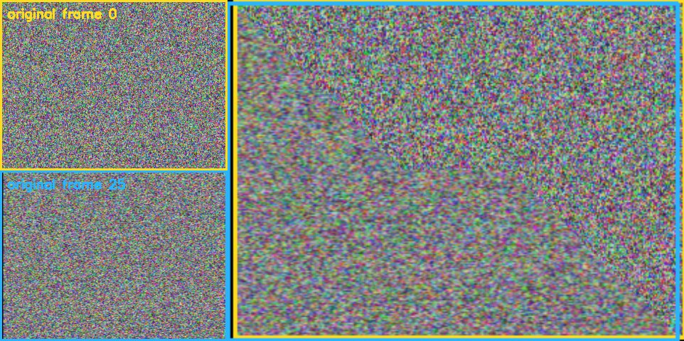

# GrassVIO tools

I use these scripts for the CS 566 GrassVIO project.

## Homography and motion filtering

I fixed the normalized homography threshold so the inlier cutoff stays at
3 pixels. Both stitching entry points now use the same fitter. I also fixed
the loop experiment to use the actual matched endpoints and handle videos
without an endpoint match.

I added a 25-frame motion filter. It detects points at window anchors and
tracks them through the frames between them. I compare each point with the
camera-motion prediction across the window, remove points with a large
median residual, and fit RANSAC to the remaining endpoints.

The filter needs either a recording independently known to be stationary or
a supplied full camera-motion prediction, including translation. Without
one, I use a visual plane fit as a proxy. That proxy can follow moving grass,
so it does not independently separate wind from camera movement. A low gyro
reading alone does not establish that the camera is stationary.

I ran 25 regression checks and four synthetic camera/grass combinations.
The camera prediction in these tests is known exactly. The patch is
synthetic texture rather than a physical grass simulation.

| Synthetic video | Complete tracks | Static control points kept | Moving patch interior rejected | Unfiltered homography error | Filtered homography error |
|---|---:|---:|---:|---:|---:|
| Camera still, grass static | 813 | 100% | n/a | <0.001 px | <0.001 px |
| Camera still, grass moving | 813 | 100% | 100% | 9.762 px | 0.184 px |
| Camera moving, grass static | 800 | 100% | n/a | 0.007 px | 0.007 px |
| Camera moving, grass moving | 788 | 100% | 100% | 9.582 px | 0.234 px |

I measure homography error as the mean distance between the estimated and
true transformed pixels on a fixed 7-by-5 grid. I score patch interiors away
from seams and report surviving tracks. The full counts and settings are in
[synthetic_results.json](analysis/window-filter-validation/synthetic_results.json).
I have not run this version on the original videos yet.



Install and run the checks:

```bash
python -m pip install -r requirements-dev.txt
python -m pytest -q tests
python scripts/validate_window_filter.py --outdir analysis/window-filter-validation
```

Stitch a video and put its source frames beside their warped map footprints:

```bash
python stitch-map/stitch_map.py --video input.mp4 --out map.png \
  --blend best --debug-out debug.png
```

For an independently known stationary recording:

```bash
python stitch-map/stitch_map.py --bag stationary.db3 --out filtered.png \
  --motion-filter --flow-window 25 --camera-still --debug-out debug.png
```

For a moving camera, replace `--camera-still` with
`--camera-motion motion.json`. The file holds one pixel homography per input
frame, mapping input frame 0 into that frame. Use original image coordinates
and include translation. The example below describes two frames, with the
second moving +2 pixels in x and -1 pixel in y:

```json
{
  "translation_compensated": true,
  "image_transforms": [
    [[1, 0, 0], [0, 1, 0], [0, 0, 1]],
    [[1, 0, 2], [0, 1, -1], [0, 0, 1]]
  ]
}
```

The 1.5-pixel motion cutoff is an initial setting. I still need to calibrate
it on control videos and evaluate it on separate videos. Window results use
frames only through their end anchor, with 25 frames of latency. I include
the final shorter window and report its length. Flow mode uses
`--flow-window`; descriptor mode uses `--stride`.

I leave unplaced frames out of the map. After a lost flow window, later
relative fits have no known connection to the first frame, so they remain
unplaced. The renderer rejects invalid footprints and oversized canvases
before warping. `--blend best` selects the most central source sample instead
of averaging overlapping textures. It reduces averaging blur but cannot
repair incorrect poses. The JSON includes selected frame indices, missing
poses, transforms and window diagnostics.

`dataset-tools/stitch-map/stitch_map.py` calls the same implementation.
Tree mode matches all selected frame pairs and saves a checkpoint with an
image-content hash. `--loop-check` adds older-frame matching in descriptor
chain mode. Flow mode currently supports chain placement only.

## SfM frame selection

I added a two-view frame-selection check. It waits for enough angular
parallax after camera rotation is removed, checks positive-depth support,
and also fits a plane homography. Pure rotation is not a triangulation
baseline. Strong plane support is flagged because an essential-matrix
pose can be ambiguous on a plane.

```bash
python stitch-map/sfm_keyframes.py --video input.mp4 \
  --calibration camera.json --out keyframes.json --min-parallax-deg 2
```

`camera.json` contains `{"K": [[fx,0,cx],[0,fy,cy],[0,0,1]]}` with numeric
values matching the input image resolution. The input images must already
be undistorted. This script selects candidate pairs; it does not run a full
SfM reconstruction or recover metric scale.

## Other scripts and earlier results

I use `bag-exploration/explore_bag.py` to read the ROS 2 SQLite recordings
without a ROS installation.

`imu-integration-filtering/imu_fusion.py` compares accelerometer integration
with visual frame-pair distances. It writes `per_pair_distances.csv`,
`accel_filtered.csv` and `results.json`. It requires the shared features
package on `PYTHONPATH`. The earlier analyses show that IMU translation is
still unreliable; these outputs do not establish three-channel agreement.

`descriptor-benchmark/benchmark.py` compares ORB and HOG on consecutive
frame pairs, and `friday-tasks/friday_tasks.py` contains the earlier
frame-distance, RANSAC and IMU checks. Both need the shared features package.

`dataset-validation/validate.py` checks sequence folders against the schema.
`hog-work/` contains Shi-Tomasi corners with HOG descriptors and a matching
check. `stage4-motion/` contains the synthetic lawn generator, Lucas-Kanade
visual odometry and track statistics.

The earlier SIFT stitching results were 672 by 507 pixels on the September
video and 2204 by 1891 pixels on the October 7 video. The longer video
stretched near its far end. Those numbers belong to the earlier matcher;
they have not been rerun with the corrected fitter and reciprocal matching.
A high pairwise inlier count does not establish an accurate chained path.

The current priority is testing the corrected homography and window filter
on original videos. The IMU/RGB-D translation comparison also needs a video
with a known zero starting velocity. I still need matching timestamps,
calibration and a common metric scale before comparing all three channels.

I keep the related-work findings in
[motion-filter-related-work.md](research/motion-filter-related-work.md).
