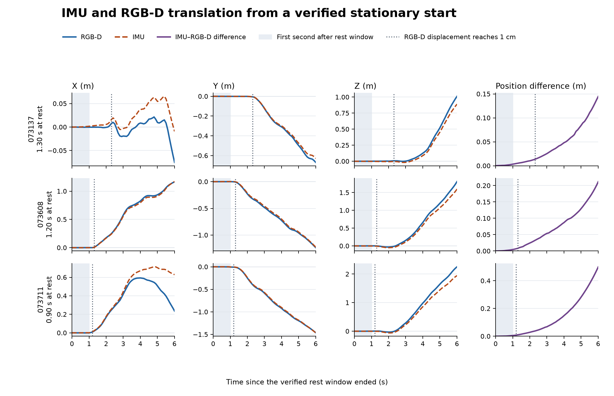

# IMU vs. RGB-D translation from rest

We repeated the translation comparison on six Nov 19 recordings. Three clips passed the stationary-start checks. On those three clips, the IMU and RGB-D translation differed by **1.9–2.7 cm over the first second after motion was detected**. The difference grew as the IMU kept integrating. This is a comparison against RGB-D odometry, with no external trajectory or stationary marker available as ground truth.



## Which recordings started from rest?

We checked the opening RGB-D frame pairs for small feature displacement and stable camera pose. We then checked the gyro and accelerometer over the same interval. The [original protocol](PROTOCOL.md) requires at least 0.5 seconds of agreement across those checks. RGB-D pose and image motion are used alongside the IMU so that a quiet gyro alone cannot establish rest.

| Nov 19 clip | Candidate opening interval | Gyro norm, 95th percentile (rad/s) | Accelerometer norm variation (m/s²) | Rest check |
|---|---:|---:|---:|---|
| `073137` | 1.30 s | 0.0091 | 0.0070 | Passed |
| `073608` | 1.20 s | 0.0126 | 0.0124 | Passed |
| `073711` | 0.90 s | 0.0108 | 0.0166 | Passed |
| `074041` | 1.10 s | 0.0216 | 0.0196 | Gyro exceeded threshold |
| `074125` | 0.50 s | 0.0236 | 0.0358 | Gyro exceeded threshold |
| `074200` | 0.80 s | 0.0268 | 0.0236 | Gyro exceeded threshold |

For each qualifying clip, the IMU starts with zero velocity at the end of the verified window. The rest samples give the initial gyro bias and the combined gravity and accelerometer offset. The comparison uses the same camera timestamps and the same starting camera axes. Time offsets came from an existing fit to visual rotation near the start. Once initialized, the IMU integration receives no visual pose updates or translation fitting.

## How closely did the estimates agree?

The original scoring times were 0.3 and 1.0 seconds after the verified window ended. The table shows why those checks were **unscored** and what the estimates did at the original 3-second checkpoint. A pass under the original protocol would require new recordings with at least 1 cm of displacement at the two scoring times, following a verified stationary start.

| Clip | RGB-D displacement at 0.3 s | RGB-D displacement at 1.0 s | RGB-D displacement at 3.0 s | IMU displacement at 3.0 s | Position difference at 3.0 s |
|---|---:|---:|---:|---:|---:|
| `073137` | 0.57 mm | 1.05 mm | 12.57 cm | 12.17 cm | 2.54 cm |
| `073608` | 0.27 mm | 1.47 mm | 76.94 cm | 73.22 cm | 5.38 cm |
| `073711` | 0.55 mm | 5.08 mm | 77.62 cm | 76.06 cm | 6.85 cm |

We also ran an exploratory comparison starting at the first RGB-D pose at least 1 cm from the rest origin. We measured both changes from that timestamp and kept the IMU integration running from the original verified rest. Here are the results one second after that detected onset.

| Clip | RGB-D displacement | IMU displacement | Difference between translation vectors | Difference relative to RGB-D displacement |
|---|---:|---:|---:|---:|
| `073137` | 19.8 cm | 19.0 cm | 1.9 cm | 9.7% |
| `073608` | 39.5 cm | 38.1 cm | 2.4 cm | 6.1% |
| `073711` | 40.4 cm | 40.3 cm | 2.7 cm | 6.6% |

The plot shows position measured from the end of rest throughout. The table above measures displacement from the detected onset, marked by the dotted line in each plot. The exploratory result describes short-term agreement on these clips and leaves the original pass criteria unscored.

We independently re-extracted the first 6.5 seconds from all six raw recordings. All six rest classifications and all three reported one-second translation differences matched the full-recording extraction.

## Reproduce the comparison

Run from this folder with Python, NumPy, OpenCV, and Matplotlib installed. Replace `PATH_TO_RECORDINGS` with the folder holding the six `.db3` files. Extraction reads the recordings in place and saves derived arrays in `extract`.

```powershell
python extract_imu_rgbd.py --input-dir PATH_TO_RECORDINGS --output-dir extract --names 20261119_073137.db3 20261119_073608.db3 20261119_073711.db3 20261119_074041.db3 20261119_074125.db3 20261119_074200.db3
python item5_analysis.py --extract-dir extract --timing timing-shifts-ms.json --out protocol-results.json
python posthoc.py extract timing-shifts-ms.json onset-results.json
python plot_translation.py extract timing-shifts-ms.json imu-vs-rgbd-translation-from-rest.png
```

[Original scoring results](protocol-results.json) · [Motion-onset results](onset-results.json) · [IMU time offsets](timing-shifts-ms.json)
