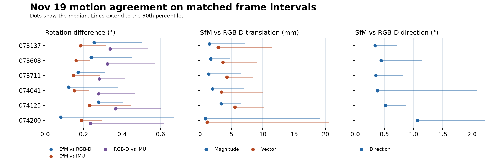

# SfM, RGB-D and IMU motion residuals

I compared the saved GrassVIO SfM and RGB-D odometry results with gyro rotations recomputed from the same six Nov 19 recordings. All three estimates were available on **126 of 131** later frame intervals. Across those common intervals, the median SfM rotation difference was **0.20° from RGB-D** and **0.16° from the calibrated gyro**. The median SfM versus RGB-D translation difference was **1.70 mm in magnitude** and **0.39° in direction** on the intervals where direction was measurable.



## Results by clip

All columns report medians except the window counts and the last column. Direction is evaluated only when both visual estimates move more than 5 mm. The vector difference captures both magnitude and direction disagreement, while the magnitude difference only compares the lengths of the two displacements.

| Clip | Common / later windows | SfM vs RGB-D rotation | SfM vs IMU rotation | RGB-D vs IMU rotation | SfM vs RGB-D magnitude | SfM vs RGB-D vector | SfM vs RGB-D direction (windows) | Vector difference, 90th percentile |
|---|---:|---:|---:|---:|---:|---:|---:|---:|
| `073137` | 28 / 28 | 0.26° | 0.19° | 0.34° | 1.48 mm | 2.89 mm | 0.34° (24) | 11.48 mm |
| `073608` | 26 / 26 | 0.24° | 0.16° | 0.32° | 1.70 mm | 3.60 mm | 0.44° (22) | 9.10 mm |
| `073711` | 22 / 22 | 0.17° | 0.15° | 0.28° | 1.34 mm | 4.29 mm | 0.35° (19) | 8.41 mm |
| `074041` | 26 / 26 | 0.12° | 0.15° | 0.28° | 1.99 mm | 3.40 mm | 0.38° (22) | 10.03 mm |
| `074125` | 15 / 15 | 0.28° | 0.23° | 0.37° | 3.34 mm | 5.54 mm | 0.52° (13) | 10.13 mm |
| `074200` | 9 / 14 | 0.08° | 0.19° | 0.24° | 0.86 mm | 1.11 mm | 1.07° (6) | 20.51 mm |

All five missing RGB-D intervals came from `074200`. That clip has the fewest common windows and the largest 90th-percentile vector difference. The [per-window CSV](window-residuals.csv) preserves those five intervals with empty residual fields.

## How the comparison works

- Each row uses the same source and target RGB frame for all three channels. SfM uses the existing multiview reconstruction, including the denser 49-view reconstruction on `074200`. RGB-D uses saved GrassVIO pairwise odometry.
- Gyro timing and bias use the existing fit against RGB-D rotation on the first 20% of each clip. The reported intervals start after that prefix. The SfM camera poses were fit using the full recording.
- I converted the two visual transforms into camera displacements expressed in the source camera axes and compared their lengths, direction, and vector difference. SfM uses its original metric scale from registered depth in one frame. There is no extra scale or trajectory fit in this comparison.
- These are local agreement measurements. SfM and RGB-D share images and depth contributes to SfM's scale. There is no external motion ground truth. IMU translation is evaluated separately on the stationary-start clips.

## Reproduce

Run from the repository root with the analysis dependencies in `requirements-analysis.txt`. Pass the Nov 19 `.db3` recording folder, the saved motion-recovery output, and the saved multiview validation output. The script accepts either `<clip>/channels.json` or `<clip>/channels/channels.json` for the motion-recovery output. The multiview output supplies `<clip>/gyro_timing.json` and `<clip>/sfm/reconstruction.json`, with `<clip>/dense_sfm/reconstruction.json` preferred where available. The existing `scripts/run_motion_recovery.py` and `scripts/run_multiview_validation.py` generate those inputs.

```powershell
python analysis/check-list-report/nov19-motion-residuals/compare_motion.py --recordings PATH_TO_RECORDINGS --rgbd-dir PATH_TO_RGBD_OUTPUT --sfm-dir PATH_TO_MULTIVIEW_OUTPUT --output-dir analysis/check-list-report/nov19-motion-residuals
```

[Python script](compare_motion.py) · [Per-window CSV](window-residuals.csv) · [Summary JSON](summary.json)
