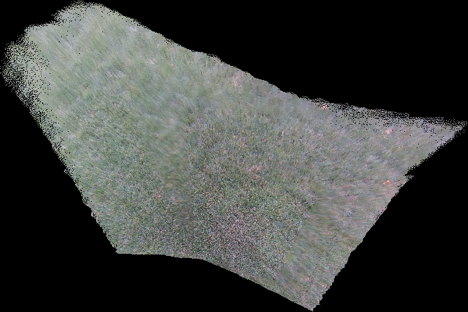
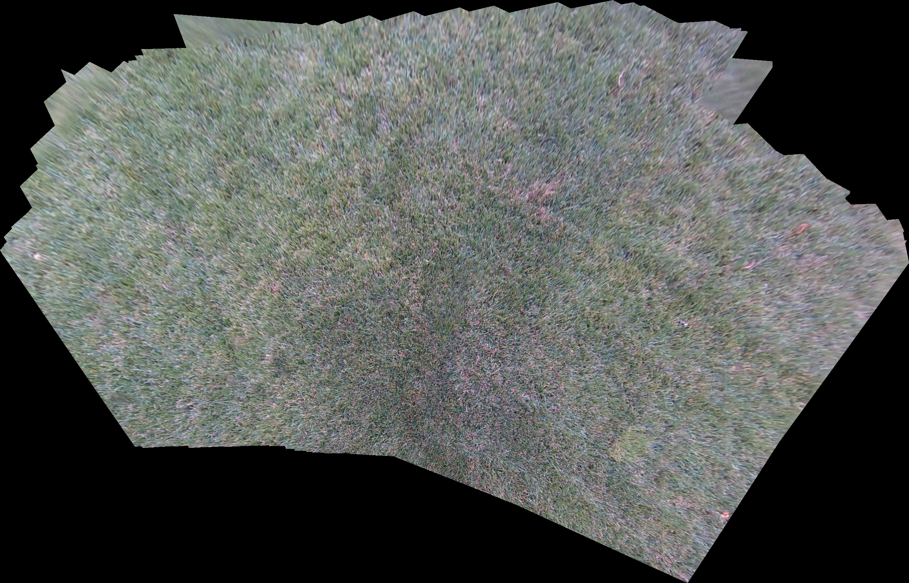
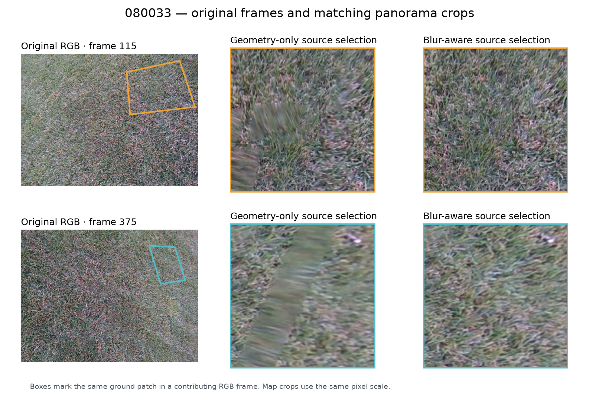

# 080033 panorama and fuzzy-map check

The old `080033` map looked soft through the middle even though the individual RGB frames still had visible grass detail. I re-rendered the clip on a flat ground plane and checked the original frames beside the same patches in the map. The clearest change came from giving sharper source frames priority where several frames covered the same spot. That removed the visible blur strips in both test crops.

## Previous map



## Updated panorama



The full maps use different projections and cover different areas. The crops below compare the same two patches at the same scale, with the original RGB frames beside them. [Compare both maps with the offline mesh reference](080033_panorama_comparison.png).



## What changed

I estimated the ground plane from depth aligned to the RGB camera and used the existing ORB-SLAM3 poses to place each frame on that plane. Then I refined the 2D homographies together using matches between overlapping views. The pose prior keeps the adjustments close to their initial placements and avoids relying on a chain of frame-to-frame warps.

The renderer samples the native RGB images directly. Each map pixel takes its color from the frame with the strongest combination of image detail, local sampling resolution and distance from the edge of the source image. A four-pixel seam band softens the joins. When the only view of a spot is soft or distant, the map still shows that limitation.

## Results

| Check | Before | After |
| --- | ---: | ---: |
| Median alignment error on 32 frame pairs held out of the refinement | 1.69 px | 0.42 px |
| Pixels assigned to the four softest sampled frames, on the same map coverage | 337,174 | 35,570 |
| Mean color jump across the same joins, before and after seam blending | 15.86 | 11.92 |

Alignment improved on 31 of the 32 held-out pairs. Each pair was scored on matching points in image tiles excluded from its match screening fit. The error is in panorama pixels. Some frames also appear in the training pairs, and the experiment has no independent ground-truth map.

The published offline mesh reference registered 46 of 89 sampled frames. The new render projected all 89, and 82 supplied at least one pixel to the full map. The comparison image shows the original map, the offline reference and the new map. Their projections and spatial extents differ, so the matched crops above use two runs of the new renderer at the same scale and coverage to isolate source selection.

The full map contains 2.67 million covered pixels on a 2498 × 1605 canvas. The higher-sampling version drops areas that only have coarse source support. It retains 65.5% of the full map's covered pixels and is the cleaner view if the soft outer areas are distracting.

## Files

- [Previous RGB-D map](../fig2_loop_map.png)
- [Full panorama](080033_full_panorama.png)
- [Panorama with a higher sampling cutoff](080033_higher_sampling_panorama.png)
- [Original map, offline reference and refined panorama](080033_panorama_comparison.png)
- [Offline mesh reference used in the comparison](080033_offline_mesh_reference.png)
- [Held-out alignment plot](080033_held_out_alignment.png) and [per-pair CSV](080033_alignment_pairs.csv)
- [Original frame 115](080033_original_frame_0115.png) and [original frame 375](080033_original_frame_0375.png)
- [Render measurements](080033_panorama_metrics.json)

## Reproduce

Run from the repository root with Python 3.11 and the team's `20261007_080033.db3` recording in `recordings/`. The [existing ORB pose JSON](../../audit-imu-preint/runs/080033_orb_poses.json) is already in the repo. The default uses every fifth color frame, a 500 px/m map grid and a 2 m maximum axial distance to the plane.

- [Panorama renderer](../../../stitch-map/plane_panorama.py) and [homography refinement](../../../stitch-map/plane_alignment.py)
- [Comparison figure script](../../../scripts/compare_plane_panorama.py)
- [Python dependencies](requirements.txt)

```bash
python -m pip install -r analysis/check-list-report/panorama-080033/requirements.txt
python stitch-map/plane_panorama.py --bag recordings/20261007_080033.db3 --poses analysis/audit-imu-preint/runs/080033_orb_poses.json --outdir local-results/080033-full --refine
python stitch-map/plane_panorama.py --bag recordings/20261007_080033.db3 --poses analysis/audit-imu-preint/runs/080033_orb_poses.json --outdir local-results/080033-geometry --refine --no-blur-weight
python stitch-map/plane_panorama.py --bag recordings/20261007_080033.db3 --poses analysis/audit-imu-preint/runs/080033_orb_poses.json --outdir local-results/080033-higher-sampling --refine --min-sampling 0.24
python scripts/compare_plane_panorama.py --bag recordings/20261007_080033.db3 --render local-results/080033-full --geometry-only-render local-results/080033-geometry --original-map analysis/check-list-report/fig2_loop_map.png --offline-reference analysis/check-list-report/panorama-080033/080033_offline_mesh_reference.png --outdir local-results/080033-report
```
