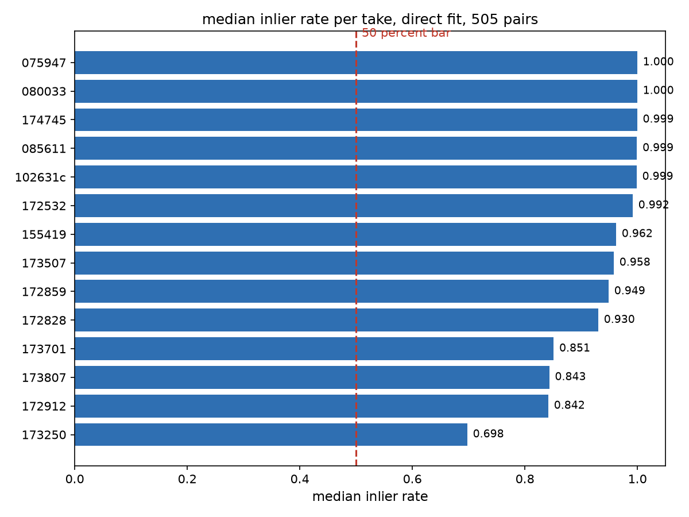
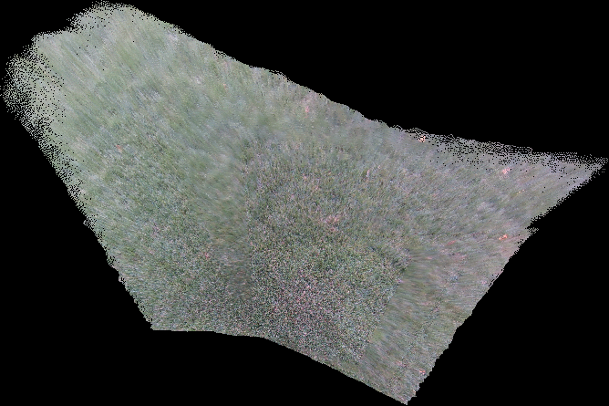
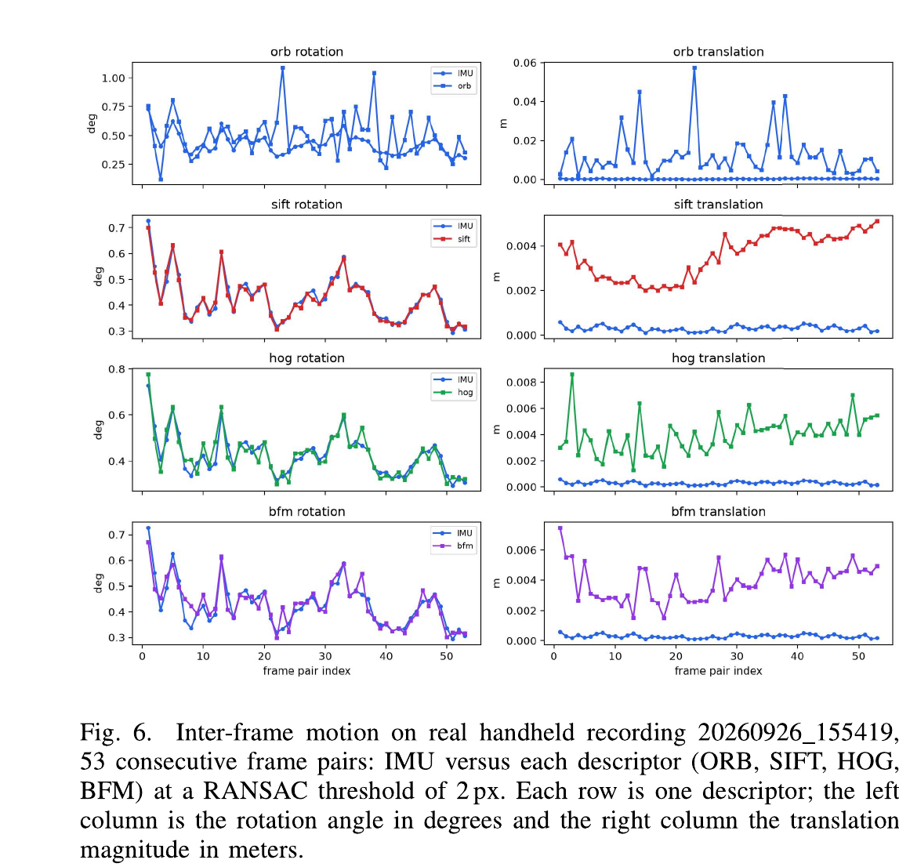
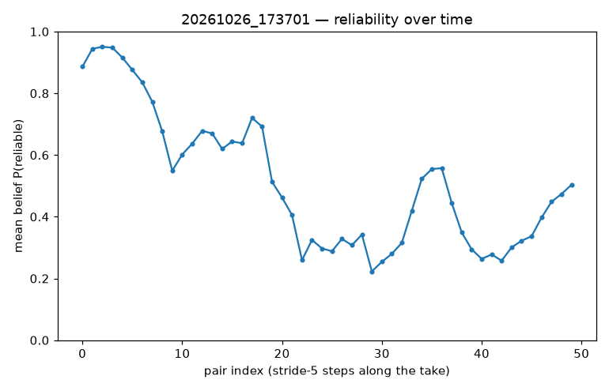
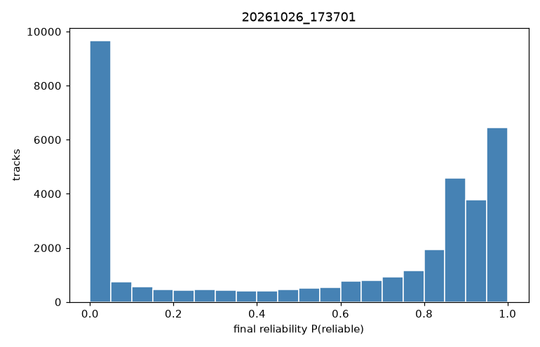

check list results

1. methods

inlier rate: sift matching on stride 5 frame pairs, lowe ratio 0.75, ransac at 3.0 px, inliers over good matches. 14 takes, 505 pairs.

r and t accuracy: sim test with true motion known, 30 pairs on 155419. loop closing end error on the real takes, orbslam3 rgbd against our own vo. our vo is sift plus lowe 0.75 on stride 5 pairs, depth back projection, solvePnPRansac, chained poses, no loop closure, no bundle adjustment.

loop closing test: end against start sift matching, last 5 frames against first 5 frames at stride 5, 25 pairs per take. the table shows the max over the 25 pairs. 20 inliers or more passes our endpoint overlap check. rgbd paths end against start.

fig 6: imu against 4 descriptors on 155419, 53 frame pairs, midterm report section 5.

reliability check: each feature gets a score for how reliable it is, from its fit residual, bayesian markov model, threshold 0.8. 3 takes: 174745 still, 173701 wind signal, 080033 rotation.

2. results

2.1 inlier rate

every take's median clears 50 percent. the median across all 505 pairs is 0.987. lowest take 173250 at 0.698. 504 of 505 pairs clear 50 percent, only 1 falls below it.

one more thing: the normalized fit counted inliers wrong, the threshold was in the wrong units, so it just counted good matches. fixed now, and the normalized count matches the direct count.

fig 1. median inlier rate per take. the dashed line is the 50 percent bar.

2.2 r and t accuracy

sim test, 30 pairs on 155419, true motion known. sim numbers are from the oct 25 team check.

| descriptor | result |
|---|---|
| sift | stays on the true motion |
| bfm | close behind sift |
| orb | off by about 1 degree in rotation and up to 1 cm in translation |
| hog | no pose at all |

sensitivity, frame to frame jitter.

| descriptor | jitter |
|---|---|
| sift | about 0.3 mm |
| hog | about 1 mm |
| bfm | about 1 mm |
| orb | 5 to 8 mm |

jitter means how much the estimated translation moves frame to frame in the sensitivity study. hog gives no pose on the combined motion sim test. the hog jitter number and the hog curve in fig 6 come from separate checks, not from that test.

2.3 loop closing test

we checked endpoint overlap by matching 5 sampled frames near the end of each take against 5 near the start. that gives 25 image pairs per take. we report the max sift inlier count across those pairs, with 20 inliers as the candidate overlap bar.

080033 has strong endpoint overlap on all 25 pairs, 1444 to 1882 inliers. 075947 runs 133 to 195 across all 25 pairs. 155419 reaches 728.

the bar also accepts the weaker takes 172532, 172828 and 172859, whose max counts are 45, 37 and 51. so this bar alone does not separate the takes we call loops from the weaker recordings. it flags possible endpoint overlap.

173807, 174702 and 174818 have zero endpoint inliers. we did not find endpoint overlap on those takes, but failed matching alone does not prove the camera never returned to its starting area. the mid-take crossing on 174702 is a separate observation from endpoint overlap.

we also measured start-to-end position separation and orientation difference for orbslam3 rgbd and our depth-backed sift pnp vo. neither method uses loop closure correction in these runs.

| take | orbslam3 | our vo | verdict |
|---|---|---|---|
| 080033 | 0.061 m, 13.0 deg | 0.836 m, 67.6 deg | yes |
| 075947 | 0.188 m, 8.8 deg | 0.580 m, 14.8 deg | yes |
| 155419 | 0.14 m, 20.3 deg | 0.108 m, 19.6 deg | yes |
| 085611 | 0.0001 m, 0.01 deg | 0.238 m, 86.3 deg | still take |
| 173807 | - | 4.926 m, 149.6 deg | no |
| 172532 | 0.81 m, 9.3 deg | 6.102 m, 101.0 deg | no |
| 172828 | 0.83 m, 59.0 deg | 5.394 m, 67.3 deg | no |
| 172859 | - | 0.838 m, 29.4 deg | nearly still |

the 174702 and 174818 paths end 5.1 m and 4.3 m from the start, and end against start matching finds 0 inliers on both. no endpoint overlap found on either.

085611 is nominally still, and 172859 is nearly still. these are useful controls, but staying near the start is different from travelling a loop.

for a verified return to the starting position, position separation measures endpoint drift. orientation difference measures rotational drift only if the camera also returns to its starting orientation. these endpoint numbers do not show accuracy along the full path.

orbslam3 has smaller endpoint separations on 080033 and 075947, while our vo has slightly smaller separations on 155419. orbslam3 is our reference baseline, not ground truth.

our vo paths end 6.1 m and 5.4 m away on 172532 and 172828, orbslam3 ends 0.81 m and 0.83 m away. the two methods disagree, so neither path alone settles the loop call.

fig 2. 080033, orbslam3 pose map. the estimated path spans 6.67 by 4.44 m, end lands 0.061 m from start. the map extent is not an independent measurement of the physical area travelled.

2.4 fig 6 translation comparison

rotation lines up well. sift follows the imu almost exactly. orb rotation is the noisy one, it overshoots to about 1.05 deg at pairs 23 and 38. translation does not line up. the imu stays under 0.6 mm per pair.

| descriptor | translation per pair |
|---|---|
| sift | 2 to 5 mm, smooth |
| hog | 1.3 to 8.6 mm |
| bfm | 1.5 to 7.5 mm |
| orb | 2 to 57 mm, isolated spikes |

fig 3. fig 6 from the midterm report, section 5. imu against orb, sift, hog and bfm on 155419, 53 frame pairs. left column rotation in degrees, right column translation in meters.

the mismatch is real, but the cause is not settled. the visual side is a two frame estimate with no stated scale, and the imu side is a per pair delta whose velocity handling is not stated. the two sides may not be measuring the same quantity. check the timestamps, the pair spacing, and the definitions before treating the curves as directly comparable. our current depth-backed sift pnp vo does produce metric translation. that does not say which translation method made this older figure. the missing velocity is a real concern, but do not say it caused fig 6 until Don confirms what was plotted. the axes also change from row to row, so the rows are hard to compare.

one note on the pair counts: 155419 has 10 pairs in the inlier test, 30 in the sim test, and 53 here, because the take is only 54 frames long and each test samples it differently.

2.5 reliability check

on 173701 only 47.2 percent of tracks score above 0.8, against 97.8 percent on the still control and 97.5 percent on the rotating take. the score falls from about 0.95 to about 0.3 halfway through the take, then moves between about 0.2 and 0.6. the signal stays while the camera is nominally still, so it is not large parallax. wind is the leading explanation, not proof.

median track length is 1, so many tracks give no repeated observations for temporal filtering. a plain residual threshold also separates these recordings. we have shown residual-based separation, not an added benefit from the markov model. the residual is the 2d reprojection error magnitude, scored with a half-normal. that is a scoring choice, not a calibrated probability.

fig 4. mean reliability over time on 173701. it starts at control level and falls halfway through the take.

fig 5. reliability histogram on 173701. the tracks split into two groups, near 0 and near 1.

2.6 add list status

| item | status |
|---|---|
| optical flow wind check | done, works over a 25 frame window |
| imu preintegration | built, translation chaining fails. end error up to 80 m, gravity about 6 deg off |
| visual pose init | built, gyro bias works. 20.5 deg vs 20.8 visual, accel bias not pinned down |
| sfm | on hold |
| semantic cues | not started |

the combined correction test ran on withheld motion and failed all 3 pre-set criteria on both loop takes. at the 0.167 s horizon on 080033, its error is 6.74 mm against 3.58 mm for constant velocity, and it loses to constant velocity at every horizon. the 3 criteria are: beat constant velocity at the 0.167 and 0.334 s horizons on both takes, a stable correction within 0.05 m/s2 across windows, and a result that barely moves when the prior loosens from 0.05 to 0.20. the vo chain prior test was not run, the pre-set stop rule was reached.

the supported imu result is the gyro rotation prior. we have not shown a useful imu translation prior on these takes.

the 6 deg gravity error is from the preintegration test. the fitted gravity direction in the init test is stable to about 0.5 deg across fits. that is stability, not independently verified gravity accuracy. those are different tests, not one number. the fitted accel bias z stays positive on every window, +0.21 to +0.33 m/s2 on 080033 and +0.31 to +0.33 on 075947, but we have not shown that is a physical sensor offset. our zero-centered 0.05 m/s2 prior was not grounded in measured bias statistics for this device. we need independent calibration to justify its mean and uncertainty.

3. findings

- every take's median clears the 50 percent inlier bar, by a wide margin. a high inlier rate means the local fit is good, not that the chained pose is good. small errors pile up along the chain, especially on close range non flat grass.
- sift stays on the true motion in sim. orb is off by about 1 deg and up to 1 cm. hog gives no pose.
- orbslam3 ends 0.061 m from the start on 080033, with no loop closure correction, against 0.836 m and 67.6 deg for our own vo.
- the genuine loops are 080033, 075947 and 155419. the 20 inlier bar also accepts the weaker takes, so it does not establish the loop labels by itself. 174702 and 174818 show no endpoint overlap.
- fig 6 rotation lines up, translation does not, and the cause of the mismatch is not settled yet.
- the reliability score separates this take from these two controls, and finds when it goes unreliable. it is not a general wind detector yet.
- the imu does not fix translation on these takes. the preintegration gravity is off by about 6 deg, and the accel bias is not pinned down by the data. the gyro bias part works, and the fitted gravity direction is stable to about 0.5 deg.

4. conclusion

every take's median inlier rate, conditional on passing lowe filtering, passes the 50 percent bar, but good pairwise fits do not guarantee a stable accumulated trajectory. endpoint matching finds strong overlap on several takes, while the 20 inlier bar also accepts weaker cases and does not establish physical loop labels.

the depth-backed pose pipeline provides metric translation. the older fig 6 comparison still needs its translation definitions and scale checked. the reliability score separates one suspected wind take from two controls, but temporal-model benefit and wind-specific detection remain unproven.

the clearest imu improvement is gyro-bias estimation. the tested translation approaches have not beaten constant velocity on withheld motion, so gyro-only rotation is the supported imu prior for now.

appendix. inlier rate per take

| take | pairs | median | p10 | below 0.50 |
|---|---|---|---|---|
| 080033 | 40 | 1.000 | 0.975 | 0 |
| 075947 | 40 | 1.000 | 0.999 | 0 |
| 155419 | 10 | 0.962 | 0.853 | 0 |
| 172532 | 40 | 0.992 | 0.986 | 0 |
| 172828 | 40 | 0.930 | 0.779 | 0 |
| 172859 | 32 | 0.949 | 0.721 | 0 |
| 102631c | 24 | 0.999 | 0.997 | 0 |
| 174745 | 39 | 0.999 | 0.999 | 0 |
| 085611 | 40 | 0.999 | 0.998 | 0 |
| 173701 | 40 | 0.851 | 0.654 | 0 |
| 173807 | 40 | 0.843 | 0.670 | 1 |
| 172912 | 40 | 0.842 | 0.655 | 0 |
| 173250 | 40 | 0.698 | 0.562 | 0 |
| 173507 | 40 | 0.958 | 0.812 | 0 |
| all 505 pairs | 505 | 0.987 | 0.703 | 1 |
