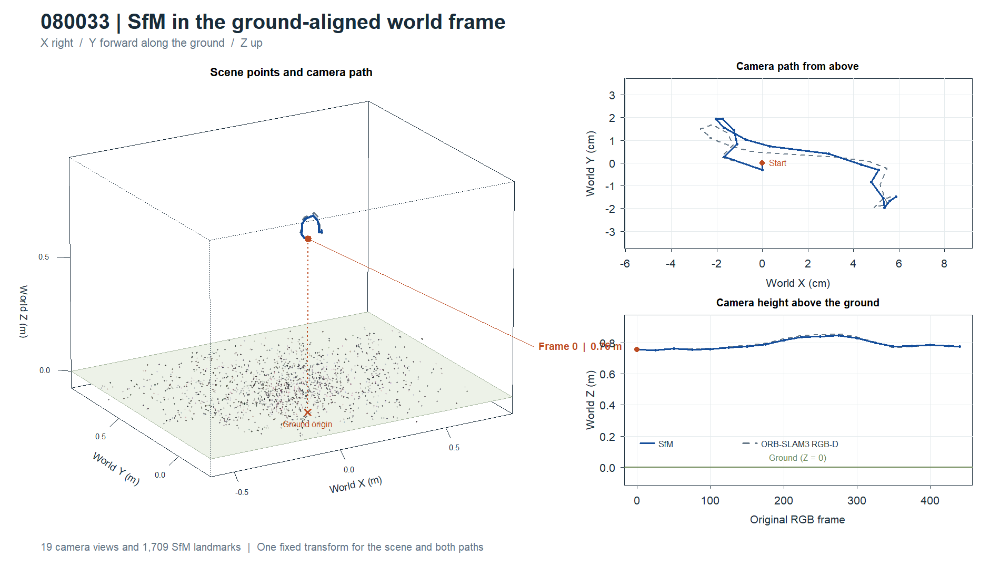

# 080033 SfM in the world frame



The grass surface defines **Z = 0**. Positive Z points up from the measured ground plane. Frame 0 starts at **(0, 0, 0.756) m** and the camera stays between **0.754 and 0.848 m** above the ground over the 19 SfM views. The median height of the 1,709 scene points is **0.8 mm** above the plane. The gap between the path and the point cloud is the camera’s height above the grass.

## Frame definition and checks

I used calibrated RGB-D depth from 12 frames to fit a single ground plane and used the ORB-SLAM3 RGB-D poses to express those measurements in the first RGB camera frame. I set the world origin on the ground directly below Frame 0. World X follows the ground-plane projection of the initial camera’s right axis, and world Y completes the right-handed frame. This gives a fixed, local frame for the recording. The origin and heading can be reused by any channel expressed in that recording’s initial RGB camera frame.

I applied one rigid transform to the SfM landmarks, the SfM poses, and the ORB-SLAM3 RGB-D poses. The original depth-derived metric scale and the relative camera motion are preserved. I excluded frame 25, which supplied the SfM scale, from the ground-plane fit and its check. Across 12 other RGB-D frames, the median distance to the fitted plane was **4.1 mm**, with a 90th percentile of **10.4 mm**. The upward normal was **2.25°** from the median calibrated accelerometer up direction, after expressing the acceleration samples in the initial camera frame. The fitted plane sets the plot’s vertical axis.

[World transform and camera poses](world-frame.json) · [Matched camera centers](world-poses.csv) · [World-frame point cloud](world-points.ply) · [Original SfM reconstruction](../sfm/README.md)

## Reproduce

Run from the repository root. The Python step uses NumPy and OpenCV. The figure uses base R.

```sh
python scripts/export_sfm_world_frame.py \
  --bag /path/to/20261007_080033.db3 \
  --sfm analysis/check-list-report/sfm/080033-reconstruction.json \
  --cloud analysis/check-list-report/sfm/080033-sparse-reconstruction.ply \
  --orb analysis/audit-imu-preint/runs/080033_orb_poses.json \
  --outdir local-results/080033-world-frame
Rscript scripts/plot_sfm_world_frame.R local-results/080033-world-frame 080033
```
