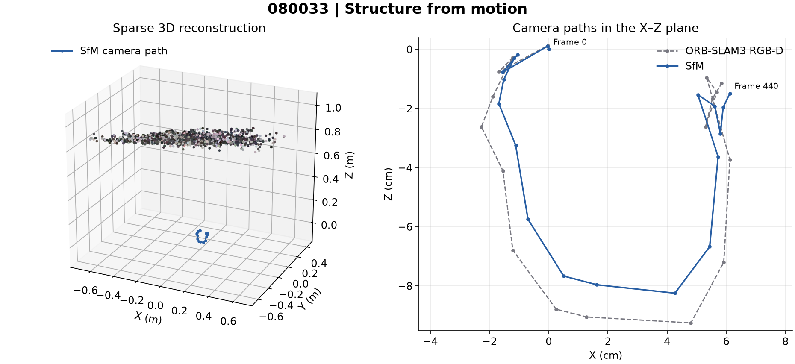

# Structure from motion on GrassVIO

I reconstructed camera paths and sparse 3D points from the RGB recordings. The `080033` reconstruction registered all 19 selected views and produced 1,709 3D points. The six November 19 recordings registered all 203 selected views.

## Frame spacing on 080033

Frames 0 and 425 gave 3.78° of median parallax after accounting for rotation. I used that pair to initialize the reconstruction, then registered and refined the other selected views. I set the metric scale using synchronized depth at frame 25 and checked the result against depth from later views.

| Measurement | Result |
|---|---:|
| Held-out image observations | 5,964 |
| Median SfM image prediction error | 0.61 px |
| Median difference from later depth measurements | 1.63 cm |
| Median camera position difference from ORB-SLAM3 RGB-D | 0.65 cm |

I compared the camera paths at the same frames in their first-camera coordinate system. The paths are estimates. An independent measurement of the camera path would be needed to verify absolute accuracy.

## Flat-ground comparison

I compared the flat-ground homography with full SfM on the same held-out image observations. The table shows median prediction error in pixels. On `080033`, the flat-ground fit had slightly lower error. SfM had lower error across all six November 19 recordings.

| Recording | Shared observations | Flat-ground homography | SfM |
|---|---:|---:|---:|
| 080033 | 5,964 | 0.55 px | 0.61 px |
| 073137 | 9,793 | 1.33 px | 0.94 px |
| 073608 | 8,999 | 1.30 px | 0.86 px |
| 073711 | 8,313 | 1.37 px | 0.99 px |
| 074041 | 9,812 | 1.69 px | 1.19 px |
| 074125 | 4,953 | 1.52 px | 1.06 px |
| 074200 | 10,019 | 0.71 px | 0.65 px |

For the homography, I used training tracks to fit the warp from the first view to the target view. For SfM, I kept the camera poses fixed and used two earlier observations to triangulate each reserved point. I then scored both predictions at the same later observation.

[080033 colored point cloud](080033-sparse-reconstruction.ply) · [Camera poses and fit diagnostics](080033-reconstruction.json) · [Later depth results](080033-heldout-depth.json)
