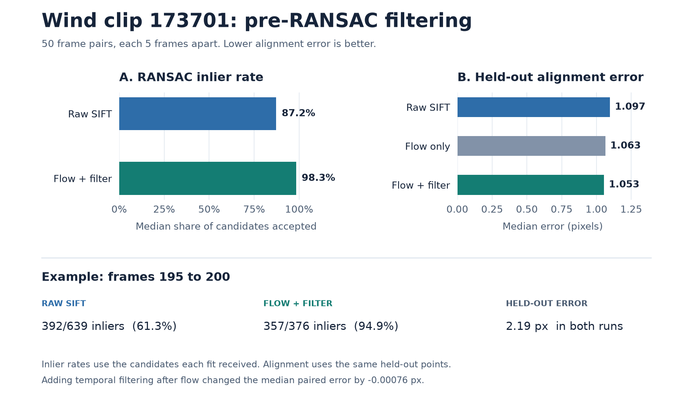
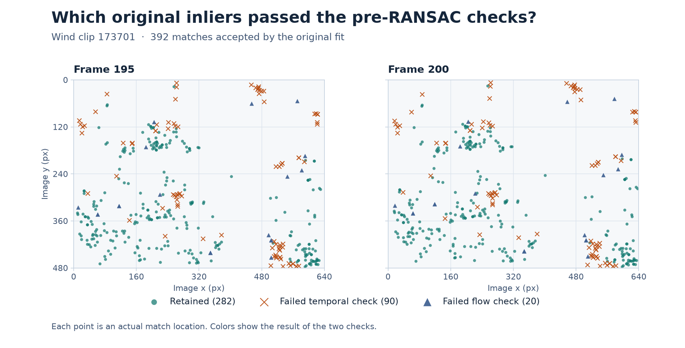

# Wind clip 173701 — pre-RANSAC filtering

The original [inlier-rate plot](../fig1_inlier_rate.png) raised a question. If the grass was moving, why were so many matches still passing RANSAC? I went back to `20261026_173701` and checked what happened when I screened the matches before fitting the homography.

Across 50 five-frame pairs, the median inlier rate went from **87.2% to 98.3%**. Each rate uses the matches that reached its own RANSAC fit, so the filtered run has a smaller pool of candidates. I scored both fits on the same points held out of the fitting process. Median alignment error went from **1.097 px to 1.053 px**, with most of the difference already visible after the flow check alone (**1.063 px**). Adding the temporal filter after that changed the median paired error by about **−0.001 px**.

## What I checked

I matched SIFT features at the two ends of each pair with a 0.75 ratio test. Then I tracked each point through the frames in between. A track had to pass the forward/backward check and finish within 2 px of its SIFT match. For the tracks that passed, I estimated a plane from the tracked points at each step and measured how far each point was from the plane's prediction. The temporal filter dropped a match if its median error across steps exceeded 1.5 px. I used the same 3 px RANSAC threshold for every fit.

I ran the fit three ways. The first used all SIFT matches, the second used matches confirmed by flow, and the third added the temporal filter. For the alignment comparison, I split the image into alternating 40 px tiles and kept the scoring tiles out of the fits and the filter's plane estimate. All three fits were scored on the same flow-confirmed matches in those tiles.

## What happened to the matches

Frames 195–200 show why the percentages need context. The original fit accepted 392 of 639 candidates (61.3%). Of those 392 original inliers, **282 passed both checks, 90 failed the temporal check, and 20 failed the flow check**. The filtered fit then accepted 357 of its 376 candidates (94.9%). The original and filtered fits both scored 2.19 px on the held-out points for this pair.

The two panels show the actual image coordinates of those 392 matches. The colors show the filter's decisions. The clip has no labels confirming which individual grass features moved, so this test measures which matches the filter removed and how the fit changed.

Across the 50 short pairs, the temporal check removed 7,101 matches after the flow check. Of those, 2,695 had passed the original RANSAC fit.

## Longer windows

| Frame spacing | Windows scored by all three fits | SIFT only | Flow check | Flow and temporal filter | Fits available before / after filtering |
| --- | ---: | ---: | ---: | ---: | ---: |
| 5 frames | 50 of 50 | 1.097 px | 1.063 px | 1.053 px | 50 of 50 / 50 of 50 |
| Up to 25 frames | 8 of 11 | 1.130 px | 1.082 px | 0.986 px | 11 of 11 / 9 of 11 |

The table gives the median of per-window median errors. All three methods needed a score for a window to count in the error comparison. The longer windows look better on that common subset, but the filtered fit was unavailable twice. On this clip, the temporal filter removed matches the baseline accepted, with little extra alignment gain beyond the flow check on the short pairs.

[Per-window counts and errors](173701_window_results.csv)
