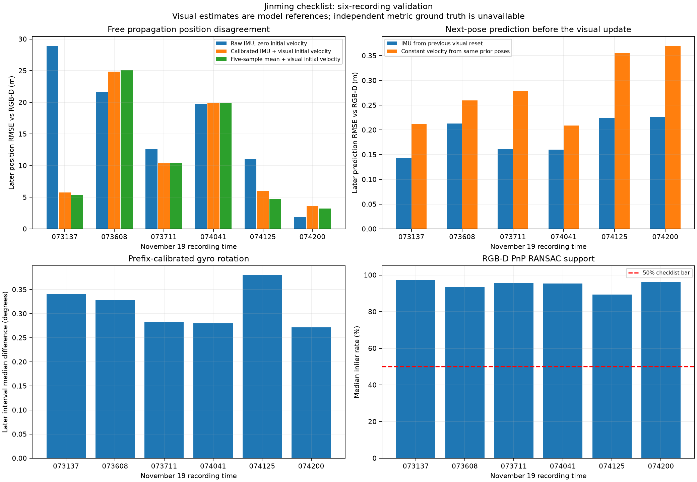

# Jinming checklist: recorded motion validation

I ran the updated channel code, gyro timing fit, constrained initialization and plotting pipeline on all six November 19 recordings. I checked every RGB-D pose against the earlier visual inputs before reusing the SfM reconstructions. All visual poses and component labels matched; this run changes inertial initialization and evaluates semantics separately.



## Measured results

Position errors below are later-window RMSE against the RGB-D model. The gyro column is the median relative rotation difference on later intervals. These are different metrics and horizons; they are not independent ground-truth accuracy.

| Recording | Raw IMU position | Initialized IMU position | Mean IMU position | Gyro rotation |
|---|---:|---:|---:|---:|
| 20261119_073137.db3 | 28.95 m | 5.76 m | 5.32 m | 0.340 deg |
| 20261119_073608.db3 | 21.62 m | 24.87 m | 25.09 m | 0.328 deg |
| 20261119_073711.db3 | 12.62 m | 10.34 m | 10.44 m | 0.283 deg |
| 20261119_074041.db3 | 19.74 m | 19.85 m | 19.86 m | 0.280 deg |
| 20261119_074125.db3 | 11.00 m | 5.97 m | 4.68 m | 0.380 deg |
| 20261119_074200.db3 | 1.89 m | 3.64 m | 3.21 m | 0.272 deg |

The initialized trajectory uses the prefix-selected gyro bias and timing plus one initial visual displacement. I subtract the measured acceleration displacement before solving for initial velocity. The mean-IMU curve uses a centered five-sample temporal mean on each sensor axis. None of these free trajectories receives later visual position corrections.

## How drift compensation was checked

For each later window, I reset position and orientation to the previous visual pose, estimate velocity from the preceding visual displacement, and then integrate IMU motion to predict the next pose. I reserve that next visual pose for scoring. The comparison baseline uses the same prior visual measurements and continues at constant velocity. The reset itself is not scored as an accurate prediction.

| Recording | IMU prediction after previous visual reset | Constant-velocity prediction | IMU improves |
|---|---:|---:|---|
| 20261119_073137.db3 | 0.143 m | 0.212 m | yes |
| 20261119_073608.db3 | 0.213 m | 0.260 m | yes |
| 20261119_073711.db3 | 0.161 m | 0.279 m | yes |
| 20261119_074041.db3 | 0.160 m | 0.209 m | yes |
| 20261119_074125.db3 | 0.224 m | 0.355 m | yes |
| 20261119_074200.db3 | 0.226 m | 0.370 m | yes |

The local IMU prediction improves the baseline on 6/6 recordings. This evaluates visual-aided predictions; it does not validate independent IMU translation. The prefix fit for velocity, accelerometer bias and gravity still fails the existing usability gates on all six recordings. Rejected fitted parameters remain out of the mapping output.

## Fig. 6 definitions and replacement figures

Each new `fig6_common_intervals` figure compares the exact same recorded source and target frames. Every translation is a source-to-target camera-transform vector in metres. Rotation uses rotation vectors in degrees. RGB-D uses recorded calibration and depth registration; SfM gets one metric scale from initial depth. The figures use a common y scale within each row. Unsupported visual intervals remain absent.

The older Fig. 6 used the September 26 video ending in 155419. I have recovered that raw recording and measured its adjacent frame pairs in [the archived-control report](../archived-controls/report.md). The exact original plotting trace remains unavailable, so these November 19 figures are replacements, not a numerical reproduction of that earlier figure. The repository does contain a separate `imu_fusion.py::imu_distance` diagnostic that resets velocity for every interval and demeans acceleration by the video mean. This can produce tiny acceleration-only displacements even during steady translation, but its existence does not establish that it generated the original Fig. 6.

The archived preintegration study for the same 155419 take gives a 1.097 m endpoint displacement when carrying velocity and 0.078 m when resetting it, a factor of 14.1. That archive uses ten stride-five pairs rather than the original figure's 53 pairs. It demonstrates sensitivity to the velocity definition without establishing the provenance or correctness of the original figure. The archived numbers are in `analysis/audit-imu-preint/runs/20260926_155419_preint.json`.

For example, a camera moving at 1 m/s with zero acceleration moves 0.0333 m in one 30 Hz interval. An acceleration-only calculation reset to zero velocity returns zero. The corrected comparison carries velocity across intervals, removes gravity in a consistent frame, includes the camera/IMU lever arm, and never compares unscaled two-view translation against metres.

## Fixes and checks

- A later low-motion gravity candidate is now rotated into the integration starting frame. A quiet IMU window alone cannot prove that the camera is stationary.
- Initial velocity uses a visual edge beginning at the integration origin and subtracts integrated acceleration. A later accumulated world position is never divided by a single-edge duration.
- Visual measurements remain in the comparison even when RGB-D cannot initialize velocity. Zero-velocity fallback is reported explicitly.
- Gyro and acceleration use trapezoidal updates. XYZ rotation plots use principal angle-axis values and break lines at branch changes, so coordinate discontinuities are not drawn as camera-motion jumps. Missing visual data also breaks lines. Orientation errors use full rotation matrices.
- The optional vegetation gate now uses 1.125 px inside the ordinary 1.5 px residual gate, so it can affect selection. A regression test demonstrates an actual extra rejection while retaining a rigid green point.
- Real-data semantic checks covered 165 windows and rejected 0 additional points. These recordings provide no labelled wind truth, and this experiment does not establish a semantic accuracy improvement.
- Ninety-four regression tests pass, including gravity-frame transport, acceleration-aware initial velocity, semantic selection, translation-transform direction, per-axis temporal averaging and the rotation plotting branch cut.

## Reproduce

```bash
python -m pip install -r requirements-analysis.txt
python scripts/run_jinming_validation.py --input-dir recordings --recovery-dir local-results/recovery --multiview-dir local-results/multiview --output-dir local-results/jinming-final
python scripts/summarize_jinming_validation.py --input-dir local-results/jinming-final --publish-dir analysis/jinming-validation
python -m pytest -q tests
```

Detailed local deliverables are `motion_report.json`, `interval_motion.csv`, four figures in PNG and SVG, and `motion_figures.pdf` for each recording. The combined `all_recording_figures.pdf` contains every recording. Input hashes, recording identity, coordinate definitions, initialization assumptions and stage logs accompany the figures. The CSV summary here is the small aggregate record; recordings and full motion traces remain local.

## What remains unresolved

Independent inertial translation remains unvalidated. The older Fig. 6 still needs its original plotting provenance to establish its exact cause; its source recording has now been recovered. Absolute rotation/translation accuracy and wind-specific detection require independent reference motion and labelled controls. The current results support gyro rotation calibration and measured visual-aided prediction checks, with those limits.
