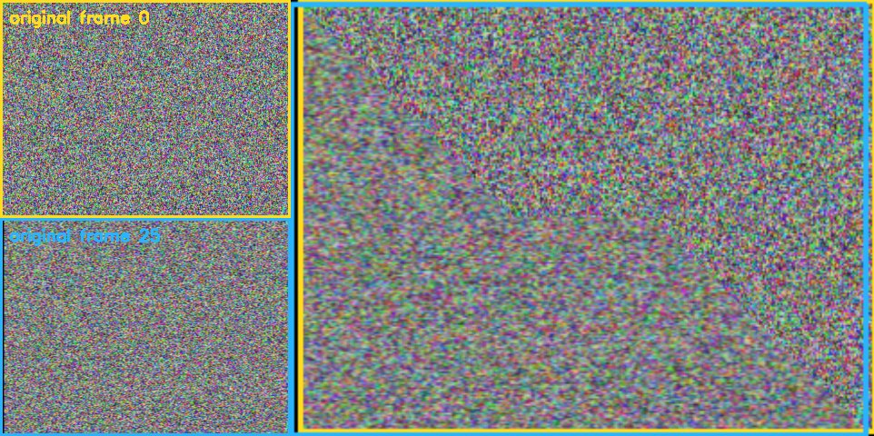

# Homography and window-motion follow-up

Implemented November 19, 2026. This is a code and synthetic validation
update. It does not replace the earlier results on real recordings.

## What changed

The main stitcher and the copy in `dataset-tools` had diverged. The second
copy now imports the main implementation, so both entry points use the same
pixel-correct normalized fit. The detector comparison scripts also import
that implementation from the actual repository layout.

The older `stable_homography.py` still passed a threshold of 3 to a fit on
normalized coordinates. That admitted errors far larger than 3 pixels.
All three entry points now share one fitter: scale the RANSAC threshold
with destination normalization, denormalize, refit the consensus, and
recompute its mask in pixels. Collinear/coincident inputs are rejected.
Descriptor matching also requires reciprocal nearest neighbours, so
multiple source points cannot inflate the count by matching one target.
Historical numbers are not silently rewritten: the new matcher/refit
changes require rerunning the original recordings before comparison.

Two other faults in the old loop experiment were that its chosen match
could connect neither frame 0 nor the final frame, but the correction
assumed those endpoints, and a take without a valid loop raised an error.
The script now composes the actual matched frames, continues the chain
from the re-anchored frame, and handles no-loop/short recordings. Linear
interpolation of projective matrices was removed. This is an endpoint
re-anchor, **not** global optimization or a claimed cure for chain drift.

Failed descriptor matches no longer get pasted at a held pose. Matching
tries the next candidate from the last successfully placed frame; missing
frames are explicit in JSON. Disconnected tree frames are excluded from
the render. Flow mode also excludes unknown poses; after a lost bridge,
subsequent relative fits remain diagnostic rather than becoming invented
absolute poses. Projective horizons, nonfinite footprints and oversized
canvases stop the render before it allocates the warp buffers. Tree
checkpoints include a content hash, shape and fitter version so another
recording with the same number of frames cannot reuse stale pairs.

The renderer samples original frames once. Average blending no longer
multiplies the interpolated boundary support twice. `--blend best` picks
the most central available source sample instead of averaging overlapping
textures. That reduces averaging blur; it cannot fix incorrect poses or
make moving grass rigid. `--debug-out` puts source frames beside their
warped map footprints for inspecting stretching.

## Window filter

`--motion-filter --flow-window 25` detects Shi-Tomasi corners at anchors,
then uses forward/backward Lucas-Kanade flow through every intervening
frame. It preserves point identities over the window. For each surviving
track, it measures the median camera-compensated residual across the
window, rejects tracks above the fixed cutoff, and **then** fits the final
RANSAC homography to the remaining endpoints. This catches oscillating
points even when their final endpoint returns to its original position.

There are three explicitly labelled sources of camera evidence:

- `--camera-still`: the recording was independently known to be stationary.
  This is an acquisition fact, not an inference from low gyro readings.
- `--camera-motion motion.json`: externally supplied frame-0-to-frame-k
  image homographies, including translation. Supply one matrix per input
  frame in original image pixel coordinates. The source must be independent
  of the grass tracks if an independent-motion claim is to be made.
- No camera input: a provisional dominant-plane model from LMedS, labelled
  `visual_plane_only`. This can follow a coherently moving grass majority,
  so it cannot establish wind/camera separation.

The supplied full-motion file has this schema (repeat the identity for
all frames only when that is the true motion):

```json
{
  "translation_compensated": true,
  "image_transforms": [
    [[1, 0, 0], [0, 1, 0], [0, 0, 1]],
    [[1, 0, 2], [0, 1, -1], [0, 0, 1]]
  ]
}
```

`image_transforms[k]` maps pixels from input frame 0 into input frame k;
the example's second frame moves by +2 pixels in x and -1 pixel in y.
The code converts these coordinates when it downsizes large images.

Gyro-only input is deliberately not accepted as full camera motion: zero
angular rate does not exclude translation. Residuals are compatibility
measurements, not wind labels. Parallax, occlusions, illumination and
tracking errors can also create residuals. Every output records that a
physical wind cause has not been verified. The 1.5-pixel default is an
engineering setting, not a cutoff calibrated on the real recordings.
Freeze/calibrate it on controls before evaluating held-out takes.

A window uses observations only through its end anchor (25 frames of
latency). The final shorter window is reported with its actual length.
Full-window tracks that fail flow validation are discarded. No unfiltered
retry is made when the filter leaves too few points. Flow mode uses its
own anchor spacing; `--stride` applies to descriptor mode. Tree/loop options
are rejected in flow mode until a persistent-track loop association exists.

## SfM conditioning check

`stitch-map/sfm_keyframes.py` compares candidate frames to the last chosen
keyframe. It checks essential geometry, positive-depth support and median
rotation-compensated angular parallax (default 2 degrees). It delays the
keyframe when the baseline is too small, and checks a planar homography as
well. Pure rotation alone is not a triangulation baseline. Strong plane
support is flagged because essential decomposition can be ambiguous on a
plane. This is a candidate selector and two-view diagnostic, **not** a full
SfM reconstruction, bundle adjustment or metric trajectory.

## Validation actually run

24 regression tests passed. Coverage includes the threshold-unit bug,
collinearity, horizon/budget rejection before warping, valid black pixels,
boundary interpolation, failed-frame placement, checkpoint invalidation,
loop composition/no-loop handling, flow tracking, endpoint-returning
oscillation, full camera compensation and pure-rotation SfM degeneracy.
Both stitch CLIs and the SfM CLI were run on generated inputs as well.

The deterministic four-case experiment uses the same generated texture,
a known full synthetic camera prior, and a large independently moving
patch. The static/dynamic classification below is scored on interior
points away from patch seams. Failed tracks are excluded; survival counts
are in `meeting-followup-validation/synthetic_results.json`.

| Synthetic case | Complete tracks | Static controls retained | Moving patch interior rejected | Unfiltered H error | Filtered H error |
|---|---:|---:|---:|---:|---:|
| Camera still, grass static | 813 | 100% | n/a | <0.001 px | <0.001 px |
| Camera still, grass moving | 813 | 100% | 100% | 9.762 px | 0.184 px |
| Camera moving, grass static | 800 | 100% | n/a | 0.007 px | 0.007 px |
| Camera moving, grass moving | 788 | 100% | 100% | 9.582 px | 0.234 px |

H error is the mean distance from estimated to known true transformed
pixels on a fixed 7-by-5 grid. Both unfiltered and filtered fits use the
same final fitter; only pre-filtering changes. These are **synthetic
best-case camera priors**, not accuracy estimates on lawn recordings, and
the patch is a tracking stress test rather than a physical grass model.



## What still needs the real recordings

The repository contains rendered maps, trajectory outputs and a four-panel
presentation video, but no raw `.db3` recordings or original frame sequences.
The presentation video was not used as raw camera input. So the following
have not been claimed complete:

- Rerun the corrected homography and window filter on original controls and
  suspected-wind takes, using matching timestamps/calibration and an
  independently justified camera-motion prior. Measure pose and overlap
  errors on held-out tracks, as well as inliers on the fitting tracks.
- Diagnose the fuzzy middle of the actual map with original frames beside
  their warped footprints. The debug output is ready, but those source
  frames are needed to decide whether pose, parallax or blending dominates.
- Repeat the IMU versus RGB-D translation check on a new recording that
  actually starts at rest. Keep common timestamps, initial velocity,
  gravity, camera/IMU extrinsics and metric scale explicit. Starting at
  rest alone does not fix accelerometer bias or gravity errors.
- Run a complete SfM reconstruction on conditioned keyframes, then compare
  its trajectory, visual odometry and IMU on common times. Existing SfM
  figures are retained as historical outputs; their missing reconstruction
  source was not invented from the figures.

The three-channel agreement objective remains unproven. This update fixes
specific code faults and provides a reproducible front end for the next
real-data comparison.
